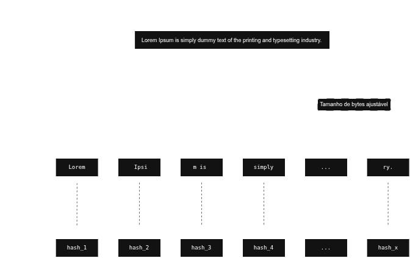
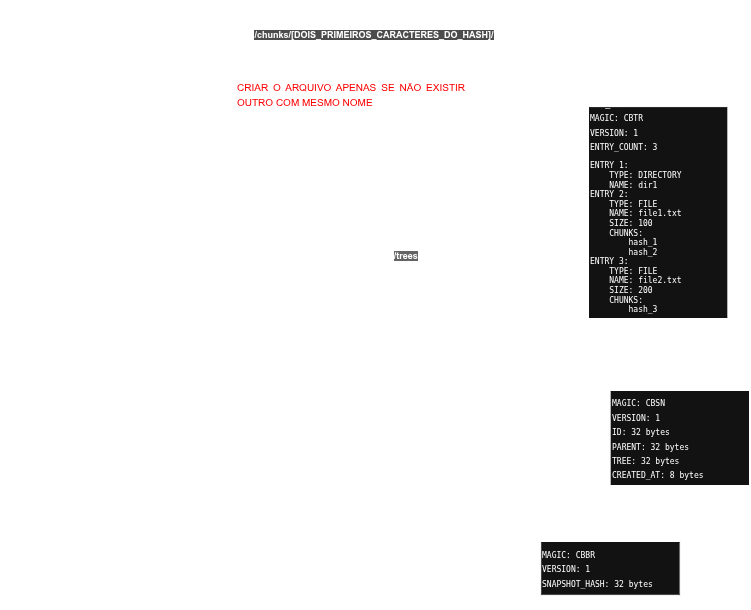

# Bakfile

## Sobre o projeto

O **Bakfile** é um sistema minimalista de versionamento e backup de arquivos, inspirado no funcionamento do Git. 
Seu objetivo é oferecer uma maneira simples e eficiente de armazenar, gerenciar e recuperar diferentes versões de um projeto.

A ideia central é utilizar a divisão de arquivos em blocos de bytes (*chunks*), identificando 
cada bloco por meio de um hash calculado com o algoritmo BLAKE3.

Dessa forma, quando um arquivo é modificado, apenas os chunks novos ou alterados precisam 
ser armazenados. Os chunks que já existem no repositório podem ser reutilizados, evitando a 
duplicação de conteúdo e reduzindo o espaço necessário para armazenamento.

Assim como o Git, o Bakfile permite manter diferentes linhas de desenvolvimento (*branches*), 
criar pontos de restauração (*snapshots*) e recuperar estados anteriores de um projeto. 
Entretanto, sua proposta é manter uma implementação minimalista, com uma estrutura própria 
de armazenamento.

## Principais objetivos

- **Armazenamento eficiente:** reduzir a duplicação de dados por meio da identificação de chunks pelo hash.
- **Versionamento:** manter o histórico de alterações de um projeto.
- **Integridade:** utilizar hashes para identificar e verificar o conteúdo dos dados armazenados.
- **Restauração:** permitir recuperar o estado completo de um projeto em versões anteriores.
- **Branches:** possibilitar diferentes linhas de desenvolvimento independentes.
- **Portabilidade:** desenvolver uma estrutura de armazenamento binária própria, com controle sobre o formato e a organização dos dados.

